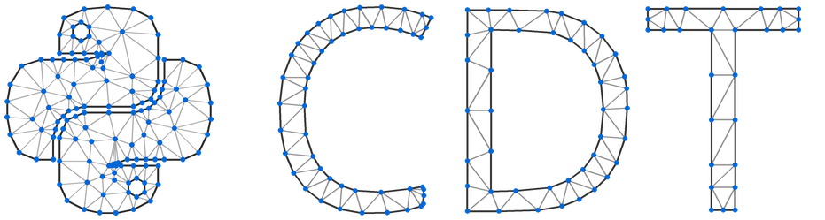
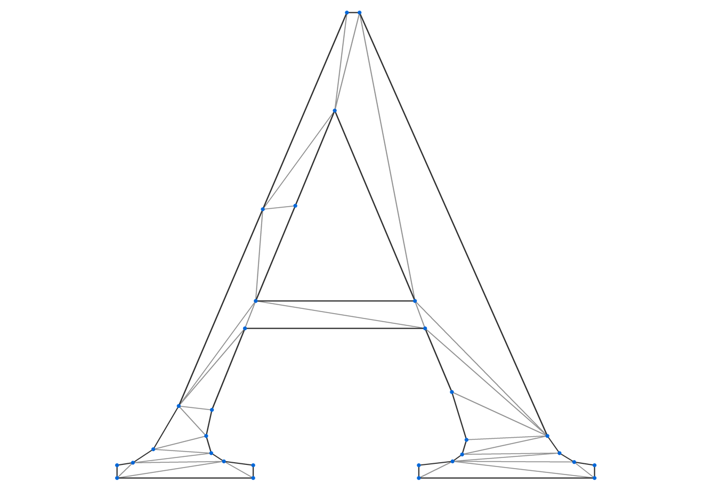

<picture><source media="(prefers-color-scheme: dark)" srcset="./docs/images/PythonCDT_logo-dark.png"></picture>

# PythonCDT

Python bindings for [CDT: C++ library for constrained Delaunay triangulation](https://github.com/artem-ogre/CDT) implemented with [pybind11](https://github.com/pybind/pybind11)

***If PythonCDT helped you please consider adding a star on [GitHub](https://github.com/artem-ogre/PythonCDT). This means a lot to the authors*** 🤩

## What can PythonCDT do?
<picture><source media="(prefers-color-scheme: dark)" srcset="https://raw.githubusercontent.com/artem-ogre/CDT/b355ebb/docs/images/show-case-dark.png"></picture>

- Constrained Delaunay triangulations: force edges into the Delaunay triangulation
- Conforming Delaunay triangulations: add new points into the Delaunay triangulation until the edges are present in the triangulation
- Refinement: add new points until triangles fulfill a minimum-angle or maximum-area criterion
- Convex hulls
- Automatically finding and removing holes

## Properly handling the corner cases
<picture><source media="(prefers-color-scheme: dark)" srcset="https://raw.githubusercontent.com/artem-ogre/CDT/b355ebb/docs/images/corner-cases-dark.png"></picture>

- Points exactly on the edges
- Exactly overlapping edges
- Resolving intersecting edges by adding points at the intersections (with `IntersectingConstraintEdges.TRY_RESOLVE`)

## Refinement
<picture><source media="(prefers-color-scheme: dark)" srcset="https://raw.githubusercontent.com/artem-ogre/CDT/b355ebb/docs/images/refinement-dark.png"></picture>

`refine_triangles()` improves the shape of the triangles by inserting new points (Steiner points). It must be called
before the triangulation is finalized: collect the triangles to remove first so that they are not refined, then
remove them with `finalize_triangulation()` (the set is updated in place).

**Limits of refinement**

<picture><source media="(prefers-color-scheme: dark)" srcset="https://raw.githubusercontent.com/artem-ogre/CDT/b355ebb/docs/images/refinement-limits-dark.png"></picture>

Some places can not be refined: e.g., a sharp angle between two constraint edges comes from the input and can not be
made any larger. `refine_triangles()` returns the counts of such refinements; `find_unrefined_triangles()` and
`find_encroached_fixed_edges()` locate them in the resulting triangulation.

## Installation

```bash
pip install pythoncdt
```

Wheels are published for Linux, macOS and Windows.

## Building from source

Building needs a C++17 compiler; pip fetches pybind11, and CMake if it is missing.

```bash
git clone --recurse-submodules https://github.com/artem-ogre/PythonCDT.git
cd PythonCDT
pip install . --group test  # needs pip 25.1+
pytest
```

Before committing, install the [pre-commit](https://pre-commit.com) hooks with `pre-commit install`: CI runs the same checks.

## Usage examples

### Constrained triangulation

<picture><source media="(prefers-color-scheme: dark)" srcset="https://raw.githubusercontent.com/artem-ogre/CDT/b355ebb/docs/images/A-dark.png"></picture>

```python
import numpy as np
import pythoncdt as cdt

vertices = np.array(
    [[0.0, 0.0], [1.0, 0.0], [1.0, 1.0], [0.0, 1.0], [0.4, 0.4]]
)
edges = np.array([[0, 1], [1, 2], [2, 3], [3, 0]], dtype=np.uintc)

t = cdt.Triangulation(
    cdt.VertexInsertionOrder.AUTO,
    cdt.IntersectingConstraintEdges.TRY_RESOLVE,
    0.0,
)
t.insert_vertices(vertices)
t.insert_edges(edges)
t.erase_outer_triangles_and_holes()

vv = t.vertices_array()  # numpy array with fields 'x' and 'y'
tt = t.triangles_array()  # numpy array with fields 'vertices' and 'neighbors'
tt["vertices"]  # (T, 3) vertex indices into vv
```

#### Notes

- `vertices_array()` and `triangles_array()` return copies. With `copy=False` they return read-only views of the
  triangulation's memory instead; a view is invalidated by any call that modifies the triangulation.

### Delaunay triangulation without constraints (triangulated convex hull)

<picture><source media="(prefers-color-scheme: dark)" srcset="https://raw.githubusercontent.com/artem-ogre/CDT/b355ebb/docs/images/LakeSuperior-dark.png"></picture>

```python
t = cdt.Triangulation(
    cdt.VertexInsertionOrder.AUTO,
    cdt.IntersectingConstraintEdges.NOT_ALLOWED,
    0.0,
)
t.insert_vertices(vertices)
t.erase_super_triangle()
```

### Conforming triangulation

<picture><source media="(prefers-color-scheme: dark)" srcset="./docs/images/A_conforming-dark.png"></picture>

```python
t = cdt.Triangulation(
    cdt.VertexInsertionOrder.AUTO,
    cdt.IntersectingConstraintEdges.TRY_RESOLVE,
    0.0,
)
t.insert_vertices(vertices)
t.conform_to_edges(edges)
t.erase_outer_triangles_and_holes()
```

#### Notes

- `conform_to_edges()` splits the constraint edges as needed, instead of keeping them as they are.

### Refined triangulation

<picture><source media="(prefers-color-scheme: dark)" srcset="https://raw.githubusercontent.com/artem-ogre/CDT/b355ebb/docs/images/A_refined-dark.png"></picture>

```python
t = cdt.Triangulation(
    cdt.VertexInsertionOrder.AUTO,
    cdt.IntersectingConstraintEdges.TRY_RESOLVE,
    0.0,
)
t.insert_vertices(vertices)
t.insert_edges(edges)

to_erase = t.collect_outer_triangles_and_holes()
unrefined = t.refine_triangles(
    1000, cdt.RefinementCriterion.SMALLEST_ANGLE, cdt.deg_to_rad(20.0), to_erase
)
t.finalize_triangulation(to_erase)
```

### Threads

Triangulating releases the GIL, so separate triangulations can be built in parallel on Python threads.
One triangulation can be shared between threads: calls on it wait for each other.
Iterators (`*_iter()`) and `copy=False` views are not protected: don't use them while another thread modifies the triangulation.

## License
[Mozilla Public License, v. 2.0](https://www.mozilla.org/en-US/MPL/2.0/FAQ/)

Bundled [CDT](https://github.com/artem-ogre/CDT) includes third-party code under other licenses:
- `predicates.h`: BSD-3-Clause, see [LICENSE-predicates.txt](CDT/CDT/LICENSE-predicates.txt)
- `portable_nth_element.hpp`: Apache-2.0 WITH LLVM-exception, see [LICENSE-LLVM.txt](CDT/CDT/LICENSE-LLVM.txt)

## Contributors
- [SioulisChris](https://github.com/SioulisChris): fixing the tests on Windows
- [sccolbert](https://github.com/sccolbert): reading the triangulation back as numpy arrays, releasing the GIL
- [mdealencar](https://github.com/mdealencar): packaging for PyPI
- [aidannewsome](https://github.com/aidannewsome): free-threading support, building wheels for PyPI

## Example Gallery
<picture><source media="(prefers-color-scheme: dark)" srcset="https://raw.githubusercontent.com/artem-ogre/CDT/b355ebb/docs/images/A-dark.png"></picture> <picture><source media="(prefers-color-scheme: dark)" srcset="https://raw.githubusercontent.com/artem-ogre/CDT/b355ebb/docs/images/A_refined-dark.png"></picture> <picture><source media="(prefers-color-scheme: dark)" srcset="https://raw.githubusercontent.com/artem-ogre/CDT/b355ebb/docs/images/A_refined_area-dark.png"></picture> <picture><source media="(prefers-color-scheme: dark)" srcset="https://raw.githubusercontent.com/artem-ogre/CDT/b355ebb/docs/images/Bean-dark.png"></picture> <picture><source media="(prefers-color-scheme: dark)" srcset="https://raw.githubusercontent.com/artem-ogre/CDT/b355ebb/docs/images/Guitar-dark.png"></picture> <picture><source media="(prefers-color-scheme: dark)" srcset="https://raw.githubusercontent.com/artem-ogre/CDT/b355ebb/docs/images/Guitar_no_holes-dark.png"></picture> <picture><source media="(prefers-color-scheme: dark)" srcset="https://raw.githubusercontent.com/artem-ogre/CDT/b355ebb/docs/images/Guitar_refined-dark.png"></picture> <picture><source media="(prefers-color-scheme: dark)" srcset="https://raw.githubusercontent.com/artem-ogre/CDT/b355ebb/docs/images/LakeSuperior-dark.png"></picture> <picture><source media="(prefers-color-scheme: dark)" srcset="https://raw.githubusercontent.com/artem-ogre/CDT/b355ebb/docs/images/Sweden-dark.png"></picture> <picture><source media="(prefers-color-scheme: dark)" srcset="https://raw.githubusercontent.com/artem-ogre/CDT/b355ebb/docs/images/Sweden_refined-dark.png"></picture> <picture><source media="(prefers-color-scheme: dark)" srcset="https://raw.githubusercontent.com/artem-ogre/CDT/b355ebb/docs/images/Overlapping_boundaries-dark.png"></picture>
